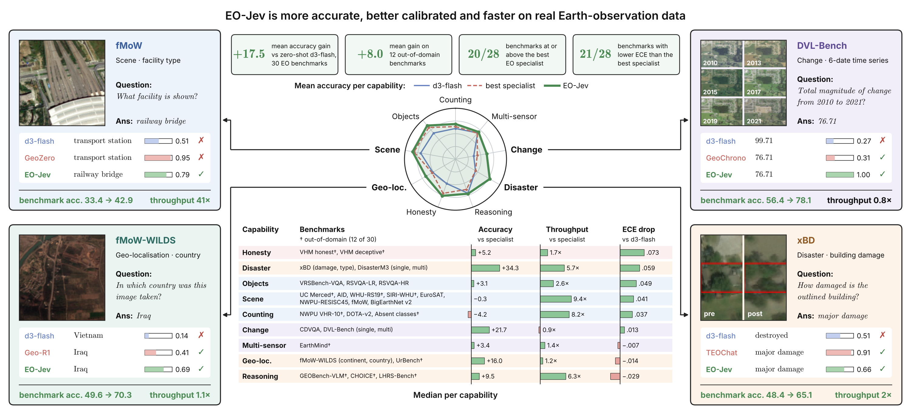
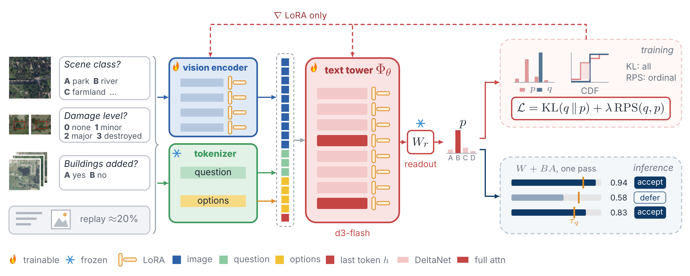

<div align="center">

# EO-Jev: Decision Model for Earth Observation

**Mohamed Atef Abouelhadid**<sup>1,†</sup> · **Diaa Addeen Abuhani**<sup>1,2,†</sup> · **Muhammad Akhtar Munir**<sup>1</sup> · **Fahad Shahbaz Khan**<sup>1,4</sup> · **Salman Khan**<sup>1,3,\*</sup>

<sup>1</sup>MBZUAI · <sup>2</sup>MIT · <sup>3</sup>Australian National University · <sup>4</sup>Linköping University
<br><sup>†</sup>Equal contribution · <sup>\*</sup>Corresponding author

[](https://mbzuai-oryx.github.io/EO-Jev/)
[](https://mbzuai-oryx.github.io/EO-Jev/#demo)
[](https://arxiv.org/abs/2611.03371)
[](https://huggingface.co/mx297/EO-Jev)
[](#citation)
[](LICENSE)

**Website: [mbzuai-oryx.github.io/EO-Jev](https://mbzuai-oryx.github.io/EO-Jev/)** · [Demo video](https://mbzuai-oryx.github.io/EO-Jev/#demo) · [Results explorer](https://mbzuai-oryx.github.io/EO-Jev/#results) · [Model on Hugging Face](https://huggingface.co/mx297/EO-Jev)



</div>

## TL;DR

Decision models answer a multiple-choice question with **a probability for every option in a single forward pass**:
no text generation, and a confidence that can be thresholded. We study a state-of-the-art decision model,
**d3-flash** (8.4B), on **30 settings from 23 public Earth-observation (EO) benchmarks**, and adapt it to EO with LoRA on
public training splits. The resulting model, **EO-Jev**:

| | |
|---|---|
| **26 / 30** | settings improved significantly over d3-flash (+23.8 points in-domain, **+8.0** on 12 held-out settings) |
| **20 / 28** | settings at or above the best open EO specialist |
| **21 / 28** | settings with lower expected calibration error than the specialist |
| **6.4×** | median throughput of the best specialist's, each at its best batch size (3.2× with one question per call) |
| **−1.8** | points on general (non-EO) decisions, the cost of adaptation |

Recognition gains come mostly from the readout: a linear probe on d3-flash's decision state already reaches 96.4 / 94.3 /
87.5 on AID / EuroSAT / NWPU-RESISC45, and EO-Jev recovers that gap. Counting, change quantification and calibration far
from the training data remain hard.

**Project page:** <https://mbzuai-oryx.github.io/EO-Jev/>: results explorer, calibration and inference-cost charts, an
example player and a one-minute demo video.

## How it works

<p align="center">
  
</p>

- **Model:** d3-flash (Qwen3.5-9B backbone, 255-code linear readout on the last prompt token) with LoRA adapters on the
  vision blocks, the vision merger and the text tower. The adapters are merged after training, so EO-Jev has the same
  architecture and inference cost as d3-flash.
- **Data:** EO decision questions built only from public training splits in six families (scene and land use, VQA,
  counting, multi-temporal change, building damage and disaster type, geo-localisation), plus about 20% general decision
  data replayed in every batch. Every training image is checked against every evaluation image by perceptual hash.
- **Loss:** KL divergence to the target distribution, plus a ranked probability score for ordinal questions.
- **Inference:** one forward pass per question; a per-question threshold accepts the answer or defers it to an analyst.

## Repository layout

| Folder | Contents |
|---|---|
| `bench/converters/` | One converter per benchmark: raw data → row files (schema in `bench/common.py`) |
| `bench/runners/` | `d3.py` (d3-flash, Qwen, EO-Jev) and `vlm.py` (specialists); chunked and resumable |
| `bench/specialists/` | Adapters for the EO specialist models, scored by option probabilities and by generated answers |
| `bench/metrics/`, `bench/analysis/` | Scoring (accuracy, F1, QWK, ECE, bootstrap CIs) and result tables |
| `bench/probes/` | Linear probes on d3-flash's decision state |
| `trainset/` | Training rows from the benchmarks' training splits, leak checks and general-data replay |
| `train/` | LoRA training (`train.py`), adapter merging and export |
| `scripts/`, `slurm/` | Downloads, environment setup, job submission, scoring |
| `docs/figures/` | The paper's figures used in this README |

Data, model weights, run outputs and logs are not in the repository. They live in folders you choose in `env.local.sh`.

## Setup

1. **Paths.** Copy `env.local.sh.example` to `env.local.sh` and set the three folders in it: models and runs, datasets,
   Python envs. `env.local.sh` is git-ignored. Every script sources `env.sh`, which reads it, so run `source env.sh` in
   your shell too.
2. **Python environments.**
   - `bash scripts/setup_env.sh` builds the main env (`eojev`): d3-flash, Qwen, the harness, training and most specialists.
   - `bash scripts/setup_specialist_envs.sh sa2va|earthdial|vhm|geochrono` builds the specialists that need older
     libraries, one env each.
3. **Models.**
   - `bash scripts/download_models.sh` fetches d3-flash and Qwen3.5-9B at pinned revisions.
   - `bash scripts/download_specialists.sh` fetches the specialist checkpoints and the authors' inference code
     (into `$EOJEV_MODELS_ROOT/third_party`).
4. **Data.**
   - The `scripts/download_*.sh` scripts download the evaluation splits to `$EOJEV_DATASETS/raw`. Some need a Hugging
     Face login, and fMoW is gated.
   - `python -m bench.converters.<benchmark>` turns them into the row files in `$EOJEV_DATASETS/converted`.
     `scripts/convert_when_ready.sh` runs each converter once its download has finished.

## Usage

**Use the trained model.** EO-Jev is on Hugging Face; the [model card](https://huggingface.co/mx297/EO-Jev) has a complete
example with an image, typed questions and the probabilities it returns.

```python
from transformers import AutoModel

model = AutoModel.from_pretrained("mx297/EO-Jev", trust_remote_code=True)
result = model.system_one(
    state="Aerial image, about 0.3 m per pixel.",
    images=["image.png"],
    questions={"airplanes": {"type": "choice", "instructions": "How many airplanes are in this image?",
                              "criteria": {"0": None, "1": None, "2": None, "3": None, "more than 3": None}}},
)
print(result["answers"]["airplanes"]["probabilities"])
```

To reproduce the paper, run everything from the repository root.

**Evaluate**

- **d3-flash, Qwen3.5-9B and EO-Jev:** `ROWS="<rows.jsonl> ..." OUT="<run dir> ..." sbatch slurm/run_d3.sbatch`.
  The script's header lists the options.
- **Specialists:** `bash scripts/specialist_runs.sh "<model> ..." both`. `scripts/specialist_plan.sh` says which model
  runs on which benchmark. Before a full run of a new model, check its answer prefix with
  `python -m bench.specialists.check_prefix <model> <rows.jsonl>`.
- **Scoring:** `bash scripts/score_all.sh` (d3 / Qwen) and `bash scripts/score_specialists.sh`.
- **Tables:** `python -m bench.analysis.summarize` and `python -m bench.analysis.specialist_table`.

**Train**

- Build the training rows with the `trainset/` sub-commands (one per source; see the docstrings), then check them
  against the evaluation sets with `trainset/check_leaks.py`.
- LoRA training: `train/train.py`'s defaults are the settings of the EO-Jev model in the paper (LoRA rank 32 on the
  text tower, 64 on the vision merger and 16 on the vision blocks at 0.2× the learning rate; 20,000 steps of 16
  questions; 20% general replay; the family mix in `train/data.py`). Training and evaluation, on 4 GPUs of one node
  (about 25 hours on A100s; resubmitting resumes from the same `--out-dir`):
  ```
  STEPS="smoke train export" TRAIN_GPUS=4 NAME=eo-jev sbatch -J eojev-train --ntasks=1 --nodes=1 \
    --gpus-per-task=4 --cpus-per-task=32 -t 24:00:00 slurm/train_eval.sbatch
  STEPS="benchmarks analyses" NAME=eo-jev sbatch -J eojev-eval --ntasks=3 --nodes=1-3 \
    --dependency=afterok:<training job> slurm/train_eval.sbatch
  ```
  `python -m train.train --help` lists the options.
- `train/merge_adapters.py` averages adapters and `train/export.py` merges them into BF16 weights for evaluation.

**Cluster settings.** The job scripts request A100 GPUs from a Slurm partition named `a100`. Change the `#SBATCH`
lines to your cluster's partition, and add `--account` (or any other options your cluster requires) there.

## Citation

```bibtex
@article{abouelhadid2026eojev,
  title   = {{EO-Jev}: Decision Model for {Earth} Observation},
  author  = {Abouelhadid, Mohamed Atef and Abuhani, Diaa Addeen and
             Munir, Muhammad Akhtar and Khan, Fahad Shahbaz and Khan, Salman},
  journal = {arXiv preprint arXiv:2611.03371},
  year    = {2026}
}
```

## License

The code in this repository is released under the [MIT License](LICENSE). Datasets, model weights and specialist
models keep their own licences.

## Acknowledgements

EO-Jev builds on [d3-flash](https://huggingface.co/vllm-sr/d3-flash) (vLLM Semantic Router) and Qwen3.5-9B, and is
evaluated on public EO benchmarks and open specialist models; we thank their authors for releasing them.
